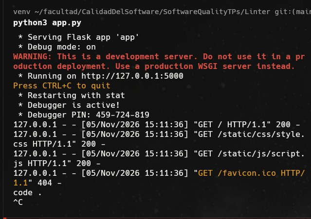
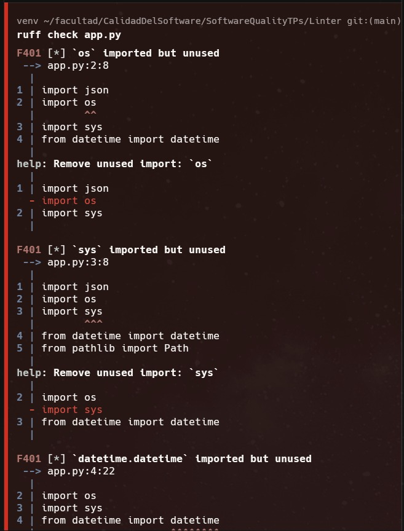
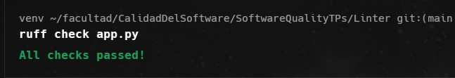

# Actividad Linter — Preguntas de cierre

## ¿La aplicación funcionaba antes de ejecutar Ruff?

Sí. Antes de ejecutar Ruff, la aplicación iniciaba correctamente con `python3 app.py` y permitía acceder a la página principal. En los registros de la ejecución local se observa una respuesta HTTP `200` para la página y sus archivos CSS y JavaScript. Esto demuestra que un programa puede funcionar y, al mismo tiempo, contener problemas de calidad en su código.

## ¿Qué tipo de problemas pudo detectar el linter sin ejecutar la aplicación?

Ruff detectó cinco problemas mediante el análisis estático del código fuente:

- **Tres importaciones sin uso (F401):** `os`, `sys` y `datetime` estaban importados, pero no se utilizaban.
- **Una captura de excepciones demasiado amplia (E722):** el bloque `except:` no especificaba qué excepciones debía manejar, por lo que podía ocultar errores inesperados e incluso interceptar interrupciones del programa.
- **Una variable local sin uso (F841):** `mensaje_temporal` recibía un valor que nunca se utilizaba.

Estos problemas podían identificarse leyendo la estructura del código, sin iniciar el servidor ni interactuar con el formulario.

## ¿Corregir los problemas detectados modificó el comportamiento del sistema?

Los cambios realizados preservaron el funcionamiento normal del registro de estudiantes. Se eliminaron las importaciones sin uso y la variable `mensaje_temporal`, cuya asignación solo contenía un texto y no intervenía en el resultado.

Para corregir E722, se reemplazó el `except:` por `except (OSError, json.JSONDecodeError):` y se eliminó la supresión de la advertencia. La función sigue devolviendo `[]` ante errores de acceso o lectura del archivo, incluido un archivo inexistente, y ante JSON mal formado. **Sí cambia intencionalmente el manejo de errores inesperados:** ahora se propagan en lugar de quedar ocultos. Por ejemplo, un `RuntimeError`, una interrupción del programa o un error de codificación UTF-8 ya no se convierten silenciosamente en una lista vacía.

La verificación con `../venv/bin/ruff check . --ignore-noqa` dio `All checks passed!`, sin depender de supresiones. Además, se ejecutaron pruebas automatizadas con el cliente de pruebas de Flask y `USERS_FILE` sustituido por una ruta temporal fuera del repositorio, sin modificar el `usuarios.json` real:

- `GET /` devolvió HTTP `200` y mostró el contador esperado antes y después de las inscripciones.
- Dos solicitudes `POST /inscripcion` devolvieron HTTP `200`, mostraron la confirmación y actualizaron el contador. Se comprobó que el JSON temporal conservaba ambas inscripciones y los datos sin espacios iniciales ni finales.
- Se verificó el retorno de `[]` ante archivo inexistente, JSON mal formado y errores simulados `PermissionError` y `OSError`; también se comprobó que `RuntimeError`, `KeyboardInterrupt`, `SystemExit` y `UnicodeDecodeError` se propagaran.

Estas pruebas no incluyeron una verificación manual en el navegador. Una respuesta HTTP `200` por sí sola no demuestra que una inscripción haya quedado guardada; por eso también se verificó el contenido persistido.

## ¿Qué valor puede aportar una herramienta de linting dentro de un proceso de calidad de software?

Una herramienta de linting permite detectar tempranamente código innecesario, prácticas riesgosas y posibles errores, antes de ejecutar la aplicación. Ayuda a mantener criterios consistentes, mejorar la legibilidad y facilitar el mantenimiento y la revisión del código. También puede automatizarse para revisar cada cambio y evitar que ciertos problemas lleguen a producción.

El linting complementa las pruebas funcionales, pero no las reemplaza: que el código supere el análisis estático no garantiza que cumpla los requisitos ni que funcione correctamente en todos los casos.
